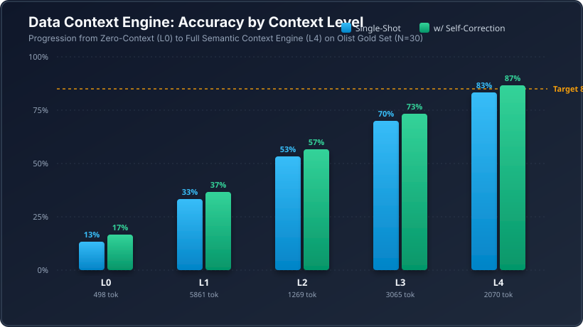
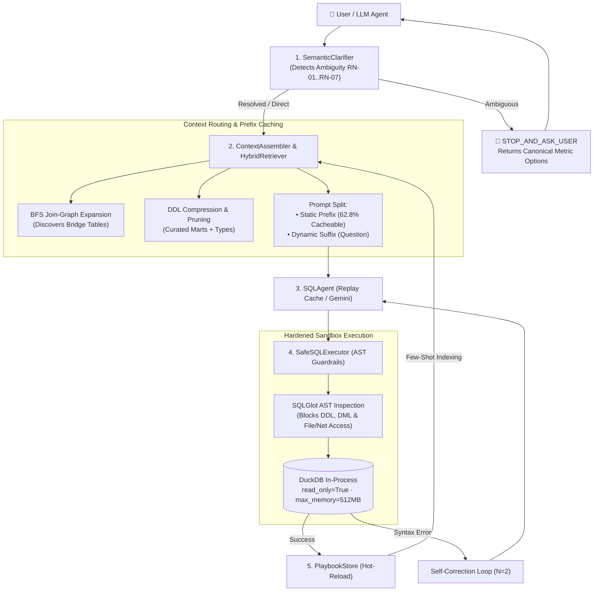

# Data Context Engine (DCE) ⚡

> 🌐 **English** · [Leia em Português (PT-BR)](README.pt-BR.md)

[](https://data-context-engine.streamlit.app)
[-10b981.svg?style=for-the-badge)](results/benchmark_summary.json)
[](results/benchmark_summary.json)
[](tests/test_guardrails_executor.py)
[-10b981.svg?style=for-the-badge)](#-test-suite--quality-assurance)

[](pyproject.toml)
[](https://duckdb.org/)
[](https://modelcontextprotocol.io/)
[](https://github.com/tobymao/sqlglot)
[](LICENSE)

**Context-aware Semantic Layer, Active Clarification, Prefix Caching, and Hardened AST SQL Guardrails for Analytical Data Warehouses.**

---

## ⚡ TL;DR — Why This Exists

Connecting an LLM directly to a production warehouse fails **not on SQL syntax**, but on **silent business-logic errors, missing join bridges, token bloat, and unsafe execution**:

- **Accuracy Leap:** Raises Text-to-SQL accuracy on 30 Olist e-commerce gold questions from **33.3% (naive schema dump)** to **83.3% single-shot** and **86.7% with self-correction (`26/30`)**.
- **Cost & Latency Control:** Cuts prompt size by **-61.3%** (`5,861 → 2,070` avg tokens) while separating an immutable static prefix (**62.8% cacheable**).
- **Deterministic Governance:** Exposes a **7-tool FastMCP server** and blocks **100% of 24 SQL injection, mutation, and file-traversal vectors** via `sqlglot` AST inspection before touching DuckDB.
- **Zero-Cost Reproducibility:** Runs 100% offline via deterministic Replay Cache and in-process DuckDB, with a live interactive workbench on **[Streamlit Cloud ↗](https://data-context-engine.streamlit.app)** and full product rationale in **[docs/PITCH.md](docs/PITCH.md)**.

---

## 📌 Problem Statement: Why Naive Text-to-SQL Fails in Production

```text
🔴 Naive Schema Dump (L1): "What is total company revenue?"
   → SUM(raw.olist_order_payments_dataset) = R$ 364,484.72
   ⚠️ Silent failure: sums canceled/returned orders and duplicates installment rows (+R$ 47,013.73 phantom revenue).

🟢 Data Context Engine (L4): "What is total company revenue?"
   → SELECT SUM(total_payment_value) FROM marts.fct_orders WHERE order_status = 'delivered' = R$ 317,470.99
   ✓ Governed result: enforces canonical rule RN-02 in 4 ms with 61.3% fewer tokens.
```

Across enterprise warehouses, naive LLM integrations fail due to five systemic bottlenecks:

1. **The Naive Schema Dump Trap:** Dumping raw, staging, and mart DDLs exhausts context attention and inflates inference cost.
2. **Semantic Ambiguity:** Executive questions like *"Who are our top 10 customers?"* have conflicting definitions (lifetime value vs. delivered order count vs. recency). Naive models guess silently.
3. **Missing Relational Graph Bridges:** Lexical/embedding retrieval skips intermediate bridge tables required in star/snowflake schemas (e.g., linking sellers to customers through order items).
4. **Execution Security Gaps:** Unaudited queries allow accidental DDL/DML (`DROP`, `DELETE`), file-traversal (`read_csv('/etc/passwd')`), or memory exhaustion.
5. **Redundant Token Spend:** Resending unseparated schemas on every turn prevents vendor *Prefix Caching* discounts.

---

## 📊 Benchmark Results (L0 – L4 on 30 Gold Questions)



Evaluated on an Olist Brazilian E-Commerce DuckDB warehouse across **30 gold-standard analytical questions** encoding 7 classic business-rule traps (`RN-01`–`RN-07`):

| Level | Strategy | Single-Shot Accuracy | w/ Self-Correction (`N=2`) | Avg Prompt Tokens | Token Savings vs. L1 |
| :---: | :--- | :---: | :---: | :---: | :---: |
| **L0** | **Zero Context** (DuckDB dialect only) | 13.3% (4/30) | 16.7% (5/30) | 498 | 90.7% |
| **L1** | **Naive Full Schema** (raw + staging + marts DDL) | 33.3% (10/30) | 36.7% (11/30) | 5,861 | 0.0% (Base) |
| **L2** | **Curated Marts** (compact analytical marts) | 53.3% (16/30) | 56.7% (17/30) | 1,269 | **76.3%** |
| **L3** | **Semantic Routing** (BM25 + BFS graph + business rules) | 70.0% (21/30) | 73.3% (22/30) | 3,065 | **42.7%** |
| **L4** | **Data Context Engine** (clarifier + metrics + few-shot + prefix cache) | **83.3% (25/30)** | **86.7% (26/30)** | **2,070** | **61.3%** |

<details>
<summary><strong>View the 7 Business Rule Traps Covered (RN-01 to RN-07)</strong></summary>

- **RN-01 (Delivered Revenue):** Only `order_status = 'delivered'` qualifies as net revenue.
- **RN-02 (Order-Level Freight):** Freight lives at the order grain (`fct_orders`), never summed per item row.
- **RN-03 (Unique Customer Identity):** Repeat customers must group by `customer_unique_id`, not transactional `customer_id`.
- **RN-04 (Actual vs. Estimated Delivery):** Carrier delay metrics compare real delivery timestamps against promised estimates.
- **RN-05 (Multi-Payment Fan-Out):** Prevents Cartesian joins between order items and split payment rows.
- **RN-06 (Review Aggregation & Categories):** Deduplicates multi-review orders and normalizes Portuguese category fallbacks (`nao_informado`).
- **RN-07 (Curated Mart Governance):** Restricts analytical agents to curated `marts` rather than uncurated `raw`/`staging` tables.

</details>

---

## 🏗️ 4-Layer Architecture



---

## ⚡ FastMCP Server (7 Atomic Agent Tools)

DCE exposes a **FastMCP (Model Context Protocol)** server so external AI agents (Claude Desktop, Cursor, Gemini) query the warehouse under strict semantic governance:

| MCP Tool | Inputs | Outputs | Agent Directive |
| :--- | :--- | :--- | :--- |
| `clarify_and_assemble_context` | `question`, `selected_metric_id`, `level` | `needs_clarification`, `agent_directive`, `full_prompt`, `inspection` | Halts on ambiguity (`STOP_AND_ASK_USER`) or proceeds (`PROCEED`). |
| `search_warehouse_context` | `query`, `top_k_per_category` | Retrieved tables, metrics, few-shots, forbidden joins | Graph-aware hybrid retrieval. |
| `get_canonical_metric` | `metric_id` (`*` for all) | Canonical SQL, mandatory filters, business rule | Prevents divergent KPI definitions. |
| `describe_mart_table` | `table_name`, `sample_rows` | Schema, primary keys, sample rows | Safe inspection of curated marts. |
| `list_saved_playbooks` | `tag` (optional) | Verified, indexed analytical playbooks | Reuses audited query patterns. |
| `save_verified_playbook` | `title`, `question`, `sql_query`, `metric_id`, `tags` | Persisted playbook hot-reloaded into `HybridRetriever` | Closed-loop few-shot memory. |
| `execute_safe_sql` | `sql_query`, `max_rows` | `success`, `ast_verified`, `columns`, `rows`, `execution_time_ms` | Sandboxed DuckDB execution. |

---

## 🛡️ Hardened AST Security & Sandbox

Every query passes deterministic validation in [`src/dce/execution/guardrails.py`](src/dce/execution/guardrails.py) before touching the database cursor:

- **Recursive `sqlglot` AST Parsing:** Unwraps CTEs and subqueries; rejects all DDL (`DROP`, `ALTER`, `CREATE`, `ATTACH`) and DML mutations (`DELETE`, `UPDATE`, `INSERT`, `COPY TO`), plus multi-statement payloads.
- **External Access Blocklist:** Blocks file-system and network functions (`read_csv`, `read_csv_auto`, `read_parquet`, `scan_parquet`, `read_text`, `glob`, `duckdb_secrets`, `INSTALL`, `LOAD`) and sensitive path literals (`.env`, `id_rsa`, `credentials`, `passwords.txt`).
- **DuckDB Isolation:** Runs with `read_only=True`, `enable_external_access=False`, `max_memory="512MB"`, `timeout_seconds=15.0`, and automatic `LIMIT` clamping (`<= 1000` rows).
- **Verified Penetration Suite:** **24/24 malicious SQL vectors blocked** in [`tests/test_guardrails_executor.py`](tests/test_guardrails_executor.py).

---

## 🖥️ Interactive Streamlit Workbench

The hosted app at **[data-context-engine.streamlit.app](https://data-context-engine.streamlit.app)** implements high-density **Anti-AI Design** (`#09090b` Zinc dark surfaces, hairline borders, `tabular-nums`):

- **Side-by-Side L1 vs. L4 Duel:** Inspects silent business-logic failures in naive L1 next to governed L4 SQL.
- **Workbench & Clarifier Flow:** Interactive disambiguation, token savings meter, static cache ratio, join-graph table inspection, and raw prompt inspector.
- **AST Attack Simulator & Benchmark Explorer:** Live adversarial query testing and monotonic L0–L4 telemetry.

---

## 🚀 Quick Start (Zero-Cost & 100% Offline)

```bash
# 1. Clone and install (Python >= 3.12)
git clone https://github.com/dantinha/data-context-engine.git
cd data-context-engine
pip install -e .

# 2. Build the local DuckDB analytical warehouse
python -m dce.cli build-db --db-path data/warehouse/olist.duckdb --samples 2000 --seed 42

# 3. Run the 30-question benchmark (replay mode = zero API cost)
python -m dce.cli bench --db-path data/warehouse/olist.duckdb --output-dir results

# 4. Launch the Streamlit Workbench
python -m dce.cli ui

# 5. Start the FastMCP server
python -m dce.cli mcp --db-path data/warehouse/olist.duckdb
```

---

## 🧪 Test Suite & Quality Assurance

```bash
pytest -v
ruff check src/ tests/ app/
```

**83 automated tests passing (100%)** across 9 suites (`test_warehouse`, `test_semantic_metadata`, `test_clarifier_retriever`, `test_assembler`, `test_guardrails_executor`, `test_benchmark_agent`, `test_playbooks`, `test_mcp_server`, and Streamlit `AppTest` E2E usability tests in `test_streamlit_ui_usability`).

---

## 📄 License

Distributed under the **MIT** license. See [`LICENSE`](LICENSE) for details.
