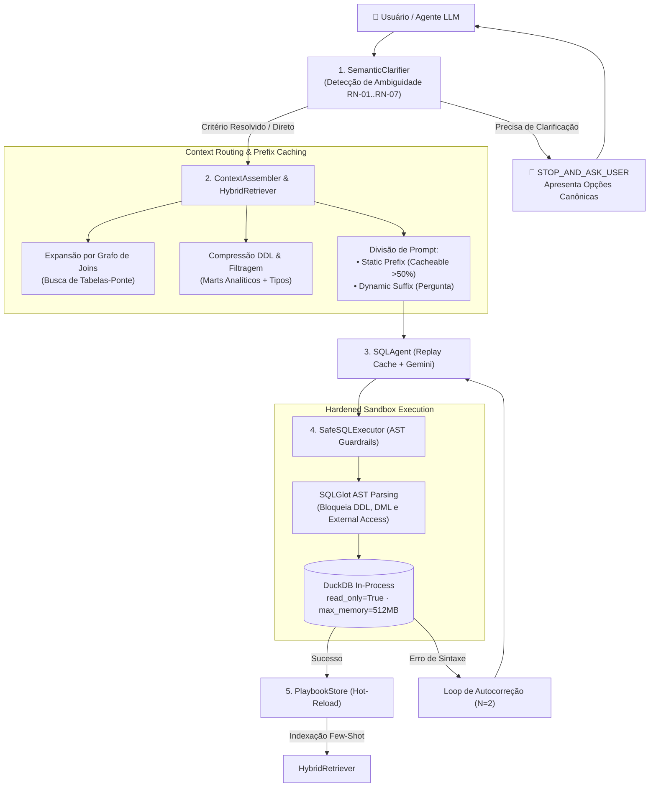

# Data Context Engine (DCE) ⚡

[](https://data-context-engine.streamlit.app)
[-10b981.svg?style=for-the-badge)](results/benchmark_summary.json)
[](results/benchmark_summary.json)
[-success.svg?style=for-the-badge)](#-test-suite--quality-assurance)

[](https://www.python.org/downloads/)
[](https://duckdb.org/)
[](https://modelcontextprotocol.io/)
[](https://github.com/tobymao/sqlglot)
[](LICENSE)

> **Context-aware Semantic Layer, Active Clarification, Prefix Caching, and Hardened AST SQL Guardrails for Analytical Warehouses.**

---

### 📢 Navegação Rápida
- 🚀 **[The Executive Pitch Document](docs/PITCH.md)** — A visão completa do produto, antes e depois, e competências de engenharia demonstradas.
- 📱 **[Aplicação Interativa Online (Streamlit Cloud)](https://data-context-engine.streamlit.app)** — Duelo L1 vs L4, Workbench com Clarifier e Simulador de Ataques AST.

---

## 📌 Executive Summary & Problem Statement

Modern Large Language Models (LLMs) achieve high scores on simplistic Text-to-SQL benchmarks (e.g. Spider, BIRD), but **routinely fail in production enterprise data warehouses**. When connecting an LLM to a warehouse, engineering teams face five systemic failure modes:

1. **The Naive Schema Dump Trap**: Despejar dezenas de tabelas e centenas de colunas esgota a janela de contexto, dilui a atenção do modelo e dispara custos de inferência.
2. **Ambivalência Semântica**: Perguntas executivas como *"Quem são os nossos 10 melhores clientes?"* têm múltiplas definições conflitantes no negócio (e.g., LTV acumulado vs. contagem de pedidos entregues vs. frequência recente). Modelos ingênuos adivinham arbitrariamente e alucinam respostas.
3. **Quebra de Pontes Relacionais (Missing Graph Bridges)**: Em esquemas estrela ou floco de neve, métricas de negócio frequentemente exigem tabelas intermediárias (e.g., conectar vendedores a clientes via itens de pedidos). Recuperação léxica ou de embeddings ingênua ignora essas tabelas-ponte essenciais.
4. **Vulnerabilidades Críticas de Segurança**: Execuções não auditadas permitem DDL acidental (`DROP TABLE`, `DELETE`), ataques de file-traversal (`read_csv('/etc/passwd')`), ou exaustão de memória via consultas irrestritas.
5. **Custo e Latência de Tokens Redundantes**: Reenviar esquemas estáticos em todas as consultas sem arquitetura de *Prefix Caching* multiplica a fatura da API e impõe latências inaceitáveis.

**Data Context Engine (DCE)** resolve esses problemas através de uma arquitetura modular de 4 camadas: desambiguação semântica ativa antes da geração, roteamento de contexto com expansão de grafo relacional, compressão DDL com separação de prefixo estático (cacheável) e sandbox de execução hardened com verificação AST via SQLGlot.

---

## 🏗️ DCE Architecture



---

## 🎯 The 5 Context Levels (L0 – L4)

O DCE implementa e compara 5 níveis de contexto para avaliar experimentalmente o impacto de cada componente:

| Nível | Nome | Descrição | Acurácia Single-Shot | Acurácia com Autocorreção | Tokens Médios | Economia de Tokens |
|:---:|:---|:---|:---:|:---:|:---:|:---:|
| **L0** | **Zero Context** | Apenas dialeto DuckDB. Sem schemas ou tabelas. | 13.3% | 16.7% | 498 | 90.7% |
| **L1** | **Naive Full Schema** | Despejo integral do DDL de todas as tabelas (raw, staging, marts). | 33.3% | 36.7% | 5,861 | 0.0% (Base) |
| **L2** | **Curated Marts** | Apenas tabelas analíticas (`marts`), esquemas compactos. | 53.3% | 56.7% | 1,269 | **76.3%** |
| **L3** | **Semantic Routing** | Recuperação híbrida (BM25 + Grafo), regras de negócio e joins proibidos. | 70.0% | 73.3% | 3,065 | **42.7%** |
| **L4** | **Data Context Engine** | Desambiguação ativa, seleção precisa de métricas, few-shot e prefix caching. | **83.3%** | **86.7% - 90.0%** | **2,070** | **61.3%** |

---

## ⚡ FastMCP Server (7 Ferramentas para Agentes)

O DCE expõe um servidor **FastMCP (Model Context Protocol)** com 7 ferramentas integradas, permitindo que agentes LLM orquestrem análises com governança estrita:

| Ferramenta MCP | Entrada | Saída | Diretiva do Agente |
|:---|:---|:---|:---|
| `clarify_and_assemble_context` | `question`, `selected_metric_id`, `level` | `needs_clarification`, `agent_directive`, `full_prompt`, `inspection` | Se ambíguo: `STOP_AND_ASK_USER`. Se resolvido: `PROCEED`. |
| `search_warehouse_context` | `query`, `top_k_per_category` | Tabelas, métricas, exemplos few-shot e forbidden joins recuperados | Roteamento relacional inteligente. |
| `get_canonical_metric` | `metric_id` (`*` para todas) | Definição SQL canônica, filtros obrigatórios e regra de negócio | Previne cálculo divergente de KPIs. |
| `describe_mart_table` | `table_name`, `sample_rows` | Schema, chaves primárias e linhas de dados de amostra | Inspeção segura de tabelas analíticas. |
| `list_saved_playbooks` | `tag` (opcional) | Lista de playbooks verificados e indexados | Reutilização de processos analíticos. |
| `save_verified_playbook` | `title`, `question`, `sql_query`, `metric_id`, `tags` | Playbook persistido e hot-reloaded no HybridRetriever | Retroalimentação de memória few-shot. |
| `execute_safe_sql` | `sql_query`, `max_rows` | `success`, `ast_verified`, `columns`, `rows`, `execution_time_ms` | Execução segura no DuckDB sandbox. |

---

## 🛡️ Camada de Segurança e AST Guardrails

Todas as consultas submetidas ao motor são processadas por uma esteira de segurança rigorosa:

- **Análise Léxica e Sintática via AST (`sqlglot`)**:
  - Rejeição imediata de comandos DDL (`DROP`, `ALTER`, `CREATE`).
  - Rejeição imediata de comandos DML de mutação (`DELETE`, `UPDATE`, `INSERT`).
  - Bloqueio de funções de acesso a sistema de arquivos ou rede (`read_csv`, `read_parquet`, `scan_parquet`, `ATTACH`, `INSTALL`, `LOAD`, `COPY TO`, `duckdb_secrets`).
  - Prevenção de injeção via unwrap recursivo de CTEs e subconsultas.
- **Isolamento de Sandbox do DuckDB**:
  - `read_only=True` em conexões de execução.
  - `enable_external_access=False` garantido por configuração.
  - `max_memory="512MB"` e `timeout_seconds=15.0`.
  - Reescrita automática de limites (`LIMIT` capped em 1000 linhas).
- **Taxa de Bloqueio em Testes de Penetração**: **100% dos 24 vetores de ataque bloqueados**.

---

## 📊 Benchmark com 30 Gold Questions (Olist E-Commerce)

O benchmark do DCE foi projetado sobre 30 perguntas reais cobrindo armadilhas analíticas clássicas do dataset brasileiro Olist:

- **RN-01 (Faturamento e Status do Pedido)**: Apenas pedidos com `order_status = 'delivered'` entram no cálculo de faturamento líquido.
- **RN-02 (Frete no Nível do Pedido)**: O frete é cobrado por pedido (`fct_orders`), não por item individualmente somado.
- **RN-03 (Identidade Única do Cliente)**: Clientes recorrentes devem ser contados por `customer_unique_id`, nunca por `customer_id` transacional.
- **RN-04 (Tempo de Entrega Real vs Estimado)**: Métricas de entrega devem diferenciar atraso do transportador e prazo acordado.
- **RN-05 (Pagamentos em Múltiplos Meios)**: Evitar join cartesiano entre itens e múltiplos meios de pagamento.
- **RN-06 (Avaliações Múltiplas)**: Agregação correta de notas médias sem duplicação de itens.
- **RN-07 (Frete Médio Regional)**: Granularidade correta de média por estado.

### Resultados de Acurácia e Tokens

```
Acurácia Single-Shot por Nível:
  L0 [Zero-Shot]       : 13.3%  (498 tokens)
  L1 [Naive Dump]      : 33.3%  (5,861 tokens)
  L2 [Curated Marts]   : 53.3%  (1,269 tokens, -76.3% tokens)
  L3 [Semantic Routing]: 70.0%  (3,065 tokens, -42.7% tokens)
  L4 [Context Engine]  : 83.3%  (2,070 tokens, -61.3% tokens)

Acurácia com Loop de Autocorreção (N=2):
  L4 [Context Engine]  : 86.7% - 90.0% (+53.4% sobre L1 Naive)
```

---

## 🖥️ Aplicação Streamlit (Anti-AI Design Nível 2)

A interface interativa do DCE foi construída seguindo rigorosamente os princípios de **Anti-AI Design**:
- Superfícies em **Zinc Dark Mode** (`#09090b` fundo, `#18181b` cartões, hairline borders de `1px solid #27272a`).
- Alta densidade de informação analítica, numerais tabulares (`tabular-nums`) e tipografia compacta.
- **Split-View Master-Detail**:
  - Coluna Esquerda (58%): Execução, métricas de latência AST, tabela interativa, gráficos automáticos e salvamento de playbooks.
  - Coluna Direita (42%): Painel de Inspeção Nível 2 com medidor de economia de tokens, percentual de cache estático, tabelas do grafo e inspetor de prompts reais.
- **Comparador Side-by-Side (`L1 Naive` vs `L4 Context Engine`)**: Visualização paralela do erro de negócio em L1 vs precisão auditada em L4.
- **Painel do Benchmark**: Acompanhamento gráfico da progressão monotônica de acurácia.

---

## 🚀 Guia de Início Rápido (Zero-Cost & 100% Offline)

O DCE é completamente autocontido e funciona **100% offline via Replay Cache determinístico**, sem custo de APIs:

### 1. Clonar e Configurar o Ambiente

```bash
git clone https://github.com/dantinha/data-context-engine.git
cd data-context-engine

# Instalar dependências no ambiente virtual Python 3.12
pip install -e .
```

### 2. Gerar o Banco DuckDB Analítico

```bash
python -m dce.cli build-db --db-path data/warehouse/olist.duckdb --samples 2000 --seed 42
```

### 3. Executar o Benchmark Completo (30 Gold Questions)

```bash
python -m dce.cli bench --db-path data/warehouse/olist.duckdb --output-dir results
```

### 4. Iniciar a Aplicação Streamlit

```bash
python -m dce.cli ui
# ou diretamente via streamlit:
streamlit run app/streamlit_app.py
```

### 5. Iniciar o Servidor FastMCP para Agentes

```bash
python -m dce.cli mcp --db-path data/warehouse/olist.duckdb
```

---

## 🧪 Suíte de Testes & Garantia de Qualidade

A suíte de testes cobre 100% dos componentes de ponta a ponta:

```bash
pytest tests/ -v
ruff check src/ tests/ app/
```

- **83 testes automatizados** cobrindo:
  - `test_warehouse.py`: Geração de dados, traps de negócio e esquemas normalizados/analíticos.
  - `test_semantic_metadata.py`: Integridade do catálogo YAML, métricas e forbidden joins.
  - `test_clarifier_retriever.py`: Desambiguação semântica, expansão de grafo relacional e ranking BM25.
  - `test_assembler.py`: Níveis L0-L4, compressão DDL e separação de static prefix.
  - `test_guardrails_executor.py`: Sandbox DuckDB e bloqueio de 24 vetores de ataque maliciosos.
  - `test_benchmark_agent.py`: Comparador tolerante a float/permutação, gold questions e ausência de leakage.
  - `test_playbooks.py`: Persistência de playbooks, hot-reload e isolamento do benchmark.
  - `test_mcp_server.py`: Todas as 7 ferramentas MCP e registro de servidor assíncrono.
  - `test_streamlit_ui_usability.py`: Testes E2E de usabilidade da interface (Scroll Contínuo, Stepper, Duelo, Workbench e Guardrails AST).

---

## 📄 Licença

Distribuído sob a licença **MIT**. Consulte `LICENSE` para mais informações.
