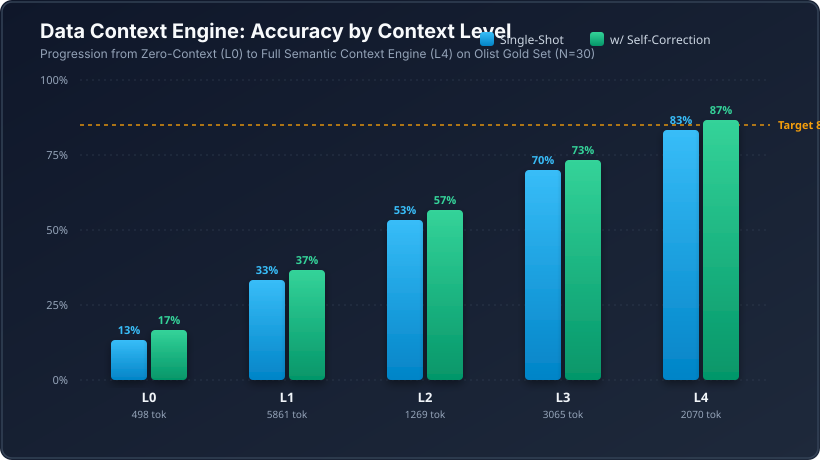
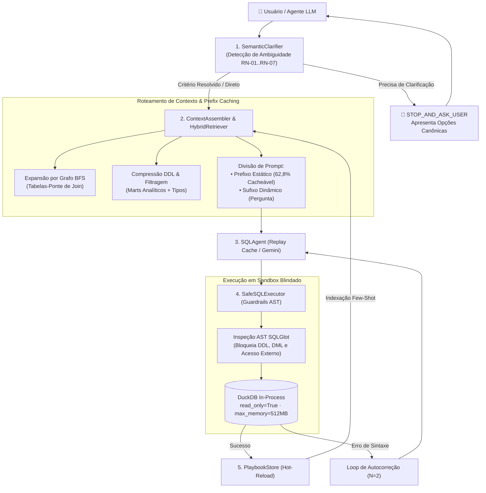

# Data Context Engine (DCE) ⚡

> 🌐 [Read in English](README.md) · **Português (PT-BR)**

[](https://data-context-engine.streamlit.app)
[-10b981.svg?style=for-the-badge)](results/benchmark_summary.json)
[](results/benchmark_summary.json)
[](tests/test_guardrails_executor.py)
[-10b981.svg?style=for-the-badge)](#-suíte-de-testes--garantia-de-qualidade)

[](pyproject.toml)
[](https://duckdb.org/)
[](https://modelcontextprotocol.io/)
[](https://github.com/tobymao/sqlglot)
[](LICENSE)

**Camada Semântica sensível ao contexto, Desambiguação Ativa, Prefix Caching e Guardrails AST para Data Warehouses Analíticos.**

---

## ⚡ Resumo Executivo — Por que Este Projeto Existe

Conectar um LLM diretamente a um data warehouse em produção falha **não por sintaxe SQL**, mas por **erros silenciosos de regra de negócio, quebra de joins intermediários, explosão de tokens e riscos de segurança**:

- **Salto de Acurácia:** Eleva a acurácia Text-to-SQL em 30 perguntas padrão-ouro do dataset Olist de **33,3% (dump ingênuo L1)** para **83,3% single-shot** e **86,7% com autocorreção (`26/30`)**.
- **Controle de Custo e Latência:** Reduz o prompt em **-61,3%** (`5.861 → 2.070` tokens médios) isolando um prefixo estático cacheável (**62,8% reaproveitável**).
- **Governança Determinística:** Expõe um servidor **FastMCP com 7 ferramentas atômicas** e bloqueia **100% de 24 vetores de injeção SQL, mutação e acesso a arquivos** via inspeção AST (`sqlglot`) antes de tocar o DuckDB.
- **Reprodutibilidade a Custo Zero:** Roda 100% offline via Replay Cache determinístico e DuckDB embarcado, com aplicação interativa online no **[Streamlit Cloud ↗](https://data-context-engine.streamlit.app)** e pitch de produto completo em **[docs/PITCH.md](docs/PITCH.md)**.

---

## 📌 O Problema Real: Por que Text-to-SQL Ingênuo Falha em Produção

```text
🔴 Dump Ingênuo de Schema (L1): "Qual o faturamento total da empresa?"
   → SUM(raw.olist_order_payments_dataset) = R$ 364.484,72
   ⚠️ Falha silenciosa: soma pedidos cancelados/devolvidos e duplica parcelas (+R$ 47.013,73 de receita fantasma).

🟢 Data Context Engine (L4): "Qual o faturamento total da empresa?"
   → SELECT SUM(total_payment_value) FROM marts.fct_orders WHERE order_status = 'delivered' = R$ 317.470,99
   ✓ Resultado governado: aplica estritamente a regra canônica RN-02 em 4 ms com 61,3% menos tokens.
```

Cinco modos sistêmicos de falha motivaram a arquitetura:

1. **Armadilha do Schema Dump:** Despejar dezenas de tabelas (`raw`, `staging`, `marts`) dilui a atenção do modelo e dispara custos.
2. **Ambiguidade Semântica:** Perguntas executivas como *"Quem são nossos 10 melhores clientes?"* possuem definições conflitantes (LTV vs. pedidos entregues vs. recorrência). Modelos ingênuos chutam sem perguntar.
3. **Quebra de Pontes Relacionais:** Recuperação léxica/vetorial pura ignora tabelas-ponte necessárias em esquemas estrela (ex.: ligar vendedores a clientes via itens de pedido).
4. **Vulnerabilidades de Execução:** Consultas não auditadas permitem DDL/DML (`DROP`, `DELETE`), leitura de arquivos locais (`read_csv('/etc/passwd')`) ou exaustão de memória.
5. **Desperdício de Tokens:** Reenviar schemas misturados à pergunta impede o uso de *Prefix Caching*.

---

## 📊 Resultados do Benchmark (L0 – L4 em 30 Gold Questions)



Avaliado sobre o warehouse DuckDB do Olist E-Commerce em **30 perguntas analíticas padrão-ouro** cobrindo 7 armadilhas clássicas de negócio (`RN-01`–`RN-07`):

| Nível | Estratégia | Acurácia Single-Shot | c/ Autocorreção (`N=2`) | Tokens Médios | Economia vs. L1 |
| :---: | :--- | :---: | :---: | :---: | :---: |
| **L0** | **Zero Context** (apenas dialeto DuckDB) | 13,3% (4/30) | 16,7% (5/30) | 498 | 90,7% |
| **L1** | **Naive Full Schema** (DDL completo `raw` + `staging` + `marts`) | 33,3% (10/30) | 36,7% (11/30) | 5.861 | 0,0% (Base) |
| **L2** | **Curated Marts** (marts analíticos compactos) | 53,3% (16/30) | 56,7% (17/30) | 1.269 | **76,3%** |
| **L3** | **Semantic Routing** (BM25 + grafo BFS + regras de negócio) | 70,0% (21/30) | 73,3% (22/30) | 3.065 | **42,7%** |
| **L4** | **Data Context Engine** (clarificador + métricas + few-shot + prefix cache) | **83,3% (25/30)** | **86,7% (26/30)** | **2.070** | **61,3%** |

<details>
<summary><strong>Ver as 7 Regras de Negócio Cobertas (RN-01 a RN-07)</strong></summary>

- **RN-01 (Faturamento Entregue):** Apenas `order_status = 'delivered'` compõe receita líquida.
- **RN-02 (Frete no Grão do Pedido):** O frete pertence a `fct_orders`, nunca somado por item.
- **RN-03 (Identidade Única do Cliente):** Recorrência agrupada por `customer_unique_id`, nunca `customer_id`.
- **RN-04 (Entrega Real vs. Estimada):** Compara timestamp real de entrega com o prazo prometido.
- **RN-05 (Múltiplos Meios de Pagamento):** Evita produto cartesiano entre itens e parcelas.
- **RN-06 (Avaliações e Categorias):** Desduplica notas e trata fallback de categoria (`nao_informado`).
- **RN-07 (Governança em Marts):** Direciona agentes para `marts` curados evitando tabelas `raw`/`staging`.

</details>

---

## 🏗️ Arquitetura em 4 Camadas



---

## ⚡ Servidor FastMCP (7 Ferramentas Atômicas)

| Ferramenta MCP | Entrada | Saída | Diretiva do Agente |
| :--- | :--- | :--- | :--- |
| `clarify_and_assemble_context` | `question`, `selected_metric_id`, `level` | `needs_clarification`, `agent_directive`, `full_prompt`, `inspection` | Se ambíguo: `STOP_AND_ASK_USER`. Se resolvido: `PROCEED`. |
| `search_warehouse_context` | `query`, `top_k_per_category` | Tabelas, métricas, few-shots e forbidden joins | Roteamento relacional híbrido. |
| `get_canonical_metric` | `metric_id` (`*` para todas) | SQL canônico, filtros obrigatórios e regra de negócio | Evita divergência no cálculo de KPIs. |
| `describe_mart_table` | `table_name`, `sample_rows` | Schema, chaves primárias e amostra de dados | Inspeção segura de marts. |
| `list_saved_playbooks` | `tag` (opcional) | Lista de playbooks verificados e indexados | Reuso de consultas auditadas. |
| `save_verified_playbook` | `title`, `question`, `sql_query`, `metric_id`, `tags` | Playbook salvo e recarregado no `HybridRetriever` | Retroalimentação few-shot. |
| `execute_safe_sql` | `sql_query`, `max_rows` | `success`, `ast_verified`, `columns`, `rows`, `execution_time_ms` | Execução segura no DuckDB. |

---

## 🛡️ Camada de Segurança e Guardrails AST

Toda consulta é auditada em [`src/dce/execution/guardrails.py`](src/dce/execution/guardrails.py) antes de tocar o banco:

- **Análise AST via `sqlglot`:** Desembrulha CTEs e subqueries; bloqueia DDL (`DROP`, `ALTER`, `CREATE`, `ATTACH`), DML (`DELETE`, `UPDATE`, `INSERT`, `COPY TO`) e múltiplos statements.
- **Bloqueio de Acesso Externo:** Barra funções de leitura/rede (`read_csv`, `read_parquet`, `scan_parquet`, `read_text`, `glob`, `duckdb_secrets`, `INSTALL`, `LOAD`) e caminhos sensíveis (`.env`, `id_rsa`, `credentials`, `passwords.txt`).
- **Sandbox DuckDB:** `read_only=True`, `enable_external_access=False`, `max_memory="512MB"`, `timeout_seconds=15.0` e teto automático de `LIMIT 1000`.
- **100% de Bloqueio:** **24 de 24 vetores de ataque bloqueados** em [`tests/test_guardrails_executor.py`](tests/test_guardrails_executor.py).

---

## 🚀 Guia de Início Rápido (Zero-Cost & 100% Offline)

```bash
# 1. Clonar e instalar (Python >= 3.12)
git clone https://github.com/dantinha/data-context-engine.git
cd data-context-engine
pip install -e .

# 2. Gerar o banco DuckDB analítico
python -m dce.cli build-db --db-path data/warehouse/olist.duckdb --samples 2000 --seed 42

# 3. Rodar o benchmark de 30 perguntas (modo replay = custo zero)
python -m dce.cli bench --db-path data/warehouse/olist.duckdb --output-dir results

# 4. Iniciar a aplicação Streamlit
python -m dce.cli ui

# 5. Iniciar o servidor FastMCP
python -m dce.cli mcp --db-path data/warehouse/olist.duckdb
```

---

## 🧪 Suíte de Testes & Garantia de Qualidade

```bash
pytest -v
ruff check src/ tests/ app/
```

**83 testes automatizados aprovados (100%)** em 9 suítes (incluindo testes E2E de usabilidade Streamlit via `AppTest`).

---

## 📄 Licença

Distribuído sob a licença **MIT**. Consulte [`LICENSE`](LICENSE).
