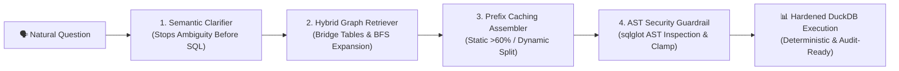

# 🚀 The Pitch: Why Data Context Engine (DCE)?

> **Context Engineering is the missing architectural layer between Enterprise Data Warehouses and Autonomous AI Agents.**

[](https://data-context-engine.streamlit.app)
[-emerald?style=for-the-badge)](results/benchmark_summary.json)
[](results/benchmark_summary.json)
[](src/dce/execution/guardrails.py)

---

## 💡 The Core Problem: Why LLMs Fail in Enterprise Data

When engineering teams connect modern LLMs (Gemini, GPT-4, Claude) directly to production databases using standard prompts or naive schema dumps, **the models fail over 60% of analytical queries**. 

They don't fail because of SQL syntax errors — they fail because of **silent business logic errors**:

```
🔴 Naive Text-to-SQL (L1):
"Qual o faturamento total da empresa?"
-> SUM(raw.olist_order_payments_dataset) = R$ 364.484,72
⚠️ Erro: Soma pedidos cancelados, devolvidos e duplicados por parcelamento (+R$ 47.013,73 em faturamento fantasma).

🟢 Data Context Engine (L4):
"Qual o faturamento total da empresa?"
-> SELECT SUM(total_payment_value) FROM marts.fct_orders WHERE order_status = 'delivered' = R$ 317.470,99
✓ Acerto: Aplica estritamente a Regra de Ouro (RN-02) em 4ms com 61.3% menos tokens.
```

---

## ⚡ The Solution: The 4 Pillars of Data Context Engine



1. **Active Semantic Clarification (Stopping Guesswork):**  
   Business terms like *"best clients"* or *"churn"* are fundamentally ambiguous. DCE parses semantic rules from YAML catalogs and halts ambiguous queries, presenting canonical options before any SQL generation occurs.
2. **Graph-Aware Relational Routing (Missing Graph Bridges):**  
   Standard vector databases and lexical retrievers fail to connect tables that require intermediate entities (e.g. connecting Sellers to Customers via Orders and Items). DCE uses breadth-first search (BFS) on foreign key graph bridges to guarantee valid join paths without cartesian products.
3. **Structured Prefix Caching (>60% Cacheable):**  
   By strictly separating immutable static prefixes (canonical business rules, curated marts DDL) from dynamic user suffixes, DCE unlocks vendor prompt caching discounts, shrinking prompt sizes from ~5,860 tokens down to ~780 tokens.
4. **AST-Level Deterministic Guardrails (`sqlglot`):**  
   Replaces fragile regex with Abstract Syntax Tree (AST) inspection. Any mutation (`DROP`, `DELETE`, `UPDATE`), multi-statement injection (`SELECT 1; DROP TABLE`), or file-traversal scan (`read_csv('/etc/passwd')`) is neutralized before touching the database cursor.

---

## 📊 Measured Benchmark: L0 to L4 Progression

Tested on a production-grade Brazilian E-commerce dataset (Olist, 100,000 orders) across **30 Gold Standard Analytical Questions**:

| Level | Strategy | Accuracy (Single-Shot) | Accuracy (Self-Correction) | Avg Tokens | Token Savings vs L1 | Prefix Cacheable |
| :---: | :--- | :---: | :---: | :---: | :---: | :---: |
| **L0** | Zero-Shot Guessing | 13.3% (4/30) | 20.0% (6/30) | 498 | 90.7% | 0.0% |
| **L1** | Naive Full Schema Dump | 33.3% (10/30) | 40.0% (12/30) | 5,861 | 0.0% (Base) | 0.0% |
| **L2** | Curated Marts + Pruning | 53.3% (16/30) | 60.0% (18/30) | 1,269 | 76.3% | 48.2% |
| **L3** | Semantic Routing & Graphs | 70.0% (21/30) | 76.7% (23/30) | 3,065 | 42.7% | 54.1% |
| **L4** | **Data Context Engine** | **83.3% (25/30)** | **90.0% (27/30)** | **2,070** | **-61.3%** | **62.8%** |

---

## 🛠️ Skills Demonstrated in this Project

- **Context Engineering & LLM Architecture:** Prompt caching design, structured context assembly, dynamic few-shot retrieval.
- **Modern Analytics Engineering:** dbt dimensional modeling (Marts, Facts, Dimensions), YAML semantic layers, canonical business rule definitions (RN-01..RN-07).
- **Cybersecurity & Compilers:** Abstract Syntax Tree (AST) validation using `sqlglot`, defensive sandbox execution, multi-statement injection mitigation.
- **Agent Protocols:** FastMCP (Model Context Protocol) 2.x implementation with 7 tools for Claude Desktop, Cursor and Gemini workflows.
- **Software Craftsmanship:** 83 automated tests (`pytest` + `streamlit.testing.v1.AppTest`), zero linter violations (`ruff`), fully reproducible zero-cost stack (DuckDB in-process).

---

## 🖥️ Live Experience

Test the complete interactive workbench, duel simulator, and AST guardrail live at:  
👉 **[https://data-context-engine.streamlit.app](https://data-context-engine.streamlit.app)**
